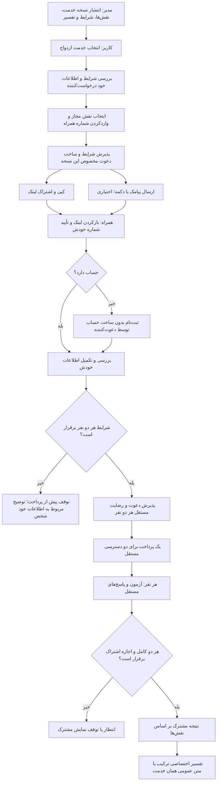

# جریان خدمت ازدواج

قرارداد پذیرفته‌شده توسط مالک؛ F12-FE01-MZ06-C01،2026-11-02.

این نمودار روند هدفِ خدمت است. اتصال اصلی دعوت و پرداخت روی PostgreSQL موقت بررسی شده؛ بررسی نهایی پیامک، مرورگر و مهاجرت دارای سابقه هنوز باقی است و کل قابلیت DONE نیست.

- داشتن حساب فقط مسیر ورود را کوتاه می‌کند؛ شرایط پذیرش یکسان است.
- نقش معنایی از ترتیب ارسال دعوت مستقل است. هر درخواست آزمون تازه دارد.
- فرستنده از وجود حساب، جنسیت یا علت شخصی عدم صلاحیت گیرنده مطلع نمی‌شود.
- لینک فقط نشانی دعوت است؛ پذیرش به حساب صاحب شماره تأییدشده وابسته است.
- لغو یا جایگزینی، پذیرش لینک قبلی را متوقف می‌کند؛ پیامک ارسال‌شده قابل پس‌گرفتن نیست.
- پذیرش سرویس‌دهنده پیامک به معنی تحویل قطعی نیست. این مسیر هنوز پذیرش عملیاتی ارسال واقعی را ندارد.
- داده و نتیجه قبلی، نسخه خدمت و اسناد مالی بازنویسی نمی‌شوند.
